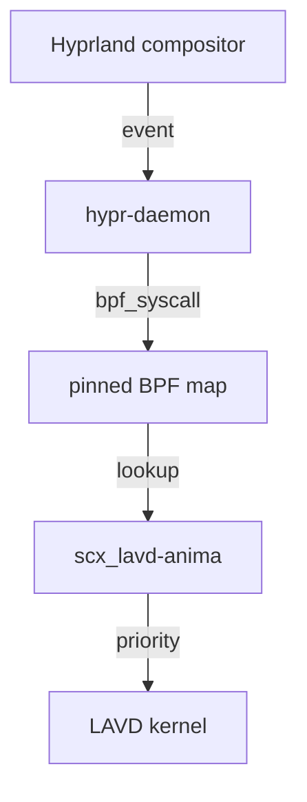

<div align=center>

# [Anima](https://github.com/animaios/anima)SchedEXT


[](https://github.com/sched-ext/scx)
[](https://hyprland.org)
[](LICENSE)

**AnimaSchedEXT** is a purpose-built fork of the
[scx_lavd](https://github.com/sched-ext/scx/tree/main/scheds/rust/scx_lavd)
(**L**atency-criticality **A**ware **V**irtual **D**eadline) scheduler from the
[sched_ext](https://github.com/sched-ext/scx) project, tuned for the desktop
gamer and interactive power user.

The core LAVD scheduler is already excellent at keeping the system responsive
under load: it classifies tasks by communication behavior and gives the most
urgent, latency-sensitive ones the tightest virtual deadlines. AnimaSchedEXT
adds one piece it was missing — awareness of which window is *actually focused
in your window manager*.

</div>

---

## How it works



Two moving parts:

- **`scx_lavd-anima`** — a patched `scx_lavd` binary that pins an
  `anima_active_pids` BPF map at `/sys/fs/bpf/anima_active_pids`. Loaded in
  place of the usual `scx_lavd` by `scx_loader`.
- **`anima-hypr-daemon`** — a standalone binary that you run as a systemd
  service alongside `scx_loader`. It watches Hyprland focus events and
  writes the focused PID into the pinned map via direct `bpf()` syscalls
  through `libbpf_rs`.

On start, the daemon reads `hyprctl clients -j` once and caches
`address → PID`. Each focus event is resolved from that cache (with a
fallback `hyprctl activewindow -j` for windows opened after daemon start).

The new PID list is then applied directly to the pinned BPF map via
`libbpf_rs::MapHandle::update` / `delete` — no `bpftool` subprocess, no
JSON parsing, no temp file. Updates are *incremental*: only stale keys are
deleted and only new keys inserted, so each focus change costs O(delta)
syscalls regardless of map size. On `SIGINT`/`SIGTERM` and on graceful
exit the map gets cleared the same way so no stale boost survives a daemon
stop.

The kernel-side LAVD sees each PID in the map and sets `lat_cri` to the
user-configurable boost level (default 896, LAVD's top LC bucket). The
focused task therefore wins dispatch on the next round without collapsing
the deadline numerator to zero. Boost level is read from the
`anima_config` BPF map, written by the daemon at startup from the
`ANIMA_BOOST` environment variable.

---

## Installation

### Prerequisites

- Linux kernel **6.12+** with `sched_ext` enabled.
- [hypridle](https://github.com/hyprwm/hypridle) or any idle daemon that
  stops the scheduler when the user goes idle (the stock `gnome-idle.target`
  setup works fine).
- Hyprland (obviously).
- `bpftool` v7.1+.
- `cargo` + `libbpf-dev` for building.

### Build

```bash
# main scheduler binary (replaces /usr/bin/scx_lavd)
cargo build --release -p scx_lavd
# userspace Hyprland focus daemon
cargo build --release --example anima_hypr_daemon -p scx_lavd
```

Install:

```bash
# Replace the default scx_lavd with our build
sudo install -Dm755 target/release/scx_lavd /usr/local/bin/scx_lavd-anima

# Install the daemon binary
sudo install -Dm755 target/release/examples/anima_hypr_daemon \
                /usr/local/bin/anima-hypr-daemon

# Install unit files
sudo install -Dm644 services/anima-scx-loader.conf \
                /etc/systemd/system/scx_loader.service.d/anima.conf
sudo install -Dm644 services/anima-hypr.service \
                /etc/systemd/system/
sudo systemctl daemon-reload
```

The drop-in `anima-scx-loader.conf` overrides `scx_loader.service` to launch
`scx_lavd-anima` instead of the stock `scx_lavd`. Combined with
`services/anima-hypr.service`, the chain at boot is:

```
systemd ──► scx_loader.service ──► scx_lavd-anima (pins BPF map)
                                       │
               anima-hypr.service ─────┘ (subscribes + updates)
```

Enable everything:

```bash
sudo systemctl enable scx_loader.service
sudo systemctl enable anima-hypr.service
sudo systemctl start scx_loader.service anima-hypr.service
```

### Tuning the boost level

The focused-window boost level is runtime-configurable via the
`ANIMA_BOOST` environment variable. Default is 896 (top 12.5% LC bucket).
Valid range: 0 (disable boost) .. 1024 (=LAVD_SCALE). Values above ~900
start collapsing `dl_delta` toward zero — tune with care.

```bash
# Optional: tune boost at runtime (default 896, max 1024)
ANIMA_BOOST=768 sudo -E /usr/local/bin/anima-hypr-daemon window+tree
```

To make the change permanent, edit `services/anima-hypr.service` and add
`Environment="ANIMA_BOOST=768"` to the `[Service]` section, then
`systemctl daemon-reload && systemctl restart anima-hypr.service`.

### Filtering heavy children (window+tree mode)

By default, `window+tree` boosts the focused PID plus its direct
children. Some of those children are background compute (a compiler
spawned from a terminal, a video encoder, the compile farm inside an
IDE) — exactly what LAVD is meant to de-prioritize.

The daemon samples each child's `/proc/<pid>/stat` for one second, two
samples apart, and drops any child whose CPU fraction during the
sampling window exceeded `ANIMA_CHILD_MAX_CPU` (default 0.5 = half a
core). Set it to 1.0 to disable filtering entirely.

```bash
# Only boost children using <30% of a core on average
ANIMA_CHILD_MAX_CPU=0.3 sudo -E /usr/local/bin/anima-hypr-daemon window+tree
```

The same environment variable is respected via systemd `Environment=`.

### Runtime

To switch between `scx_lavd` and `scx_lavd-anima` on a running system:

```bash
# Patch in
sudo systemctl stop scx_loader.service
sudo cp target/release/scx_lavd /usr/local/bin/scx_lavd-anima
sudo systemctl start scx_loader.service anima-hypr.service

# Revert
sudo systemctl stop scx_loader.service anima-hypr.service
# restore stock scx_lavd path and restart scx_loader
```

When `anima-hypr-daemon` is running, watch the focus updates:

```bash
$ journalctl -u anima-hypr.service -f
[anima] focused -> 2356175 (with 0 children)
[anima] focused -> 2356843 (with 0 children)
```

And verify the kernel saw the boost:

```bash
$ sudo bpftool map dump pinned /sys/fs/bpf/anima_active_pids
key: 0x0023 f9 6f (value 0x01)   # whatever the focused PID is
```

---

## Configuration

Edit `services/anima-hypr.service`:

- `ExecStart=/usr/local/bin/anima-hypr-daemon window` — boost only the focused window's PID. This is the right default because many GUI apps (terminals, IDEs, etc.) fork children that are background compute — exactly what LAVD is meant to de-prioritize.
- `ExecStart=/usr/local/bin/anima-hypr-daemon window+tree` — also boost direct children of the focused PID. Useful when the focused window forks a renderer/helper process you want kept snappy, but be aware: this will also boost a compiler or encoder running inside. Direct children only, never a deep tree walk.

The stock `scx_lavd` flags still apply to `scx_lavd-anima` — see the upstream
scx_lavd help. The drop-in `anima-scx-loader.conf` currently sets
`--performance`; adjust to `--balanced` or remove the flag to autopilot-mode
match your taste.

---

## How the LAVD scheduler itself works

This section is kept brief — see the upstream
[scx_lavd](https://github.com/sched-ext/scx/tree/main/scheds/rust/scx_lavd)
documentation for the full story. The很短 version:

- Every task gets a **latency criticality** score based on how frequently it
  wakes other tasks and how short its runs are. A task that sits in the middle
  of a chain like *game engine → render thread → compositor* gets a higher
  score than a long-running background compile.
- The scheduler also computes a **virtual deadline** — shorter deadline means
  LAVD picks you sooner. LC score is the denominator of that deadline.
- On `ops.enqueue`, LAVD calls `calc_lat_cri()`. Our patch adds:

  ```c
  if (is_anima_focused_pid((u32)p->pid)) {
      u32 zero = 0;
      u32 *boost = bpf_map_lookup_elem(&anima_config, &zero);
      taskc->lat_cri = boost ? *boost : LAVD_ANIMA_LC_BOOST_DFL;
  }
  ```

  This forces the focused task into LAVD's top LC bucket using the
  runtime-configurable boost level. The daemon writes the boost value into
  the `anima_config` BPF map at startup; if the lookup fails (e.g.,
  scheduler booted before the daemon), the default `LAVD_ANIMA_LC_BOOST_DFL`
  (= 896 = top 12.5% LC) applies. Setting the boost higher divides the
  deadline down to sub-ns granularity (`dl_delta == 0`), which makes the
  focused task's virtual deadline land at
  `cur_logical_CLK - LAVD_DL_COMPETE_WINDOW` — indistinguishable from any
  other starving task. That starves background work without adding useful
  priority separation. 896 (= `LAVD_SCALE * 7 / 8` = LAVD's own
  `LAVD_LC_LATENCY_SENSITIVE_THRESH`) is enough to guarantee dispatch win
  on the next round without collapsing the deadline to zero.

Caveat: preemption is cooperative. If the focused task is blocked, normal
LAVD rules apply to everything else. The boost only affects runnable PIDs, and
only the PID that Hyprland currently considers focused.

---

## Repository structure

```
anima-lavd-fork/
├── scheds/rust/scx_lavd/
│   ├── src/
│   │   ├── bpf/
│   │   │   ├── anima.bpf.h      # pinned BPF map + is_anima_focused_pid
│   │   │   ├── lat_cri.bpf.c    # patched LC calc (boost focused tasks)
│   │   │   └── main.bpf.c       # pin map at /sys/fs/bpf/anima_active_pids
│   │   └── main.rs              # scx_lavd entry, chmod pinned map
│   └── examples/
│       └── anima_hypr_daemon.rs  # standalone Hyprland focus daemon
└── services/
    ├── anima-hypr.service       # systemd unit for the daemon
    └── anima-scx-loader.conf    # drop-in that swaps in scx_lavd-anima
```

### Upstream support

AnimaSchedEXT patches land in two forms:

- The **BPF patch** (everything in `src/bpf/`): merged into sched_ext's
  scx_lavd when the community agrees. Until then, this small fork keeps the
  patches compiling against upstream releases.
- The **focus daemon + systemd units** (everything else): ships in this repo,
  not upstream. The daemon relies on Hyprland-specific IPC that upstream has
  no interest in maintaining.

Both live in the same repo so they share a version number and get tested
together.

---

## License

GPL-2.0 only — same as the upstream scx project. See [LICENSE](LICENSE).

---

## Credits

- [Changwoo Min](https://github.com/changuk-min) and the
  [Igalia](https://igalia.com/) crew for the upstream `scx_lavd` scheduler.
- [sched_ext](https://github.com/sched-ext/scx) maintainers for the BPF
  scheduler framework.
- The Hyprland project for its excellent IPC.

---

## Status

We track the upstream scx repository. Whenever scx releases a new LAVD
feature, we rebase this fork on top and re-do the few-line `is_anima_focused_pid`
patch. Bug fixes specific to the focus-daemon come from the AnimAIOS community.

If you find a bug in this patch (not in the core LAVD logic), please open
*this repo's* issues — the upstream project does not maintain the
Hyprland-specific parts.
